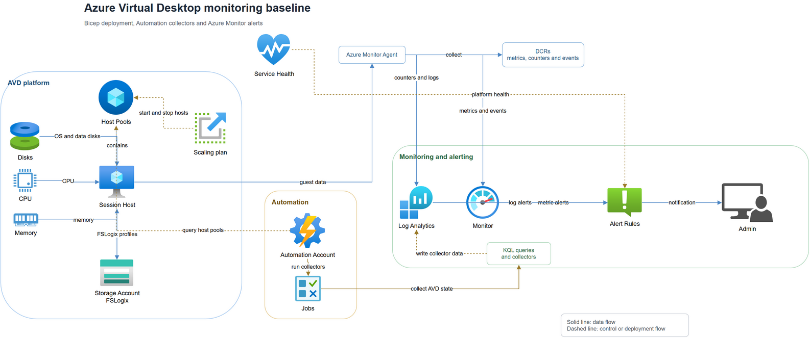

# Technical overview

This page gives a short overview of the Azure Virtual Desktop monitoring baseline. It is intended for maintainers and reviewers. For deployment steps, use the [administrator guide](administrator-guide.md).

## Architecture

The solution uses Azure Monitor, Log Analytics and Azure Automation:

Here, a **collector** is a PowerShell runbook in Azure Automation that gathers extra monitoring data.

The workspace, Azure Monitor Agent and guest-data DCR shown in the diagram are existing prerequisites. This deployment does not create them.

[](images/avd-monitoring-architecture.png)

[Editable Draw.io source](images/avd-monitoring-architecture.drawio).

The two collector runbooks collect information that Azure Monitor does not provide on its own:

- The host pool collector reports capacity, sessions, unhealthy personal hosts and scaling plan state.
- The Azure Files collector reports share usage and remaining capacity.

Each enabled runbook has four hourly schedules, staggered 15 minutes apart, so it runs every 15 minutes. The storage schedules are created only when Azure Files accounts are configured. Runbook data is sent to Log Analytics through the Automation Account diagnostic setting. Alert rules check it together with AVD diagnostics, performance counters, event logs and Azure platform metrics.

The deployment uses an existing Log Analytics workspace and creates AVD host-pool diagnostic settings that send data to it, unless `configureDiagnostics` is `false` for a pool that already has them. The workspace, Azure Monitor Agent and a DCR for the required `Perf` and `Event` data are prerequisites. Installing AMA and associating the DCR with each session-host VM are manual setup steps. The deployment does not create or associate the DCR, discover VMs, or create those VM associations.

Some alert ideas and query parts come from [Microsoft AMBA for Azure Virtual Desktop](https://azure.github.io/azure-monitor-baseline-alerts/patterns/specialized/avd/deploy/Avd-Deploy/index.html). This project is separate from Microsoft's solution.

## Main design choices

- **Three parameter blocks keep setup small.** `deployment` has the region, notification email, existing workspace details and monitoring resource group name, `hostPools` lists pools, and `additionalResources` is for optional storage and alert selection. The template creates the monitoring resource group, Action Group and Automation Account.
- **Log Analytics is the main place for queries.** It receives AVD diagnostics, collector data, performance counters and event logs.
- **Collectors use managed identity.** No credentials are stored in the runbooks. The identity receives only the required read permissions.
- **VM data setup is a prerequisite.** You install AMA and associate a DCR with session-host VMs yourself. Repeat this for new VMs.
- **You choose which alerts to turn on.** Add their IDs under `additionalResources.enabledAlertRuleIds` in the parameter file.

## Pool-specific alert names and upgrades

Alert rule names include the host pool name and a short unique value. This makes rules easier to find and keeps names unique when pools have the same name. The deployment shares `collectorFailed` and `collectorStale`; it creates `diagnosticDataMissing` and the other host-pool rules for each pool.

The optional `hostPoolType` field controls which alert resources are created. Pooled host pools get capacity alerts; personal pools get the `personalUnhealthy` alert for assigned hosts. This avoids alerts that do not fit the pool type.

One deployment can include host pools in different resource groups and subscriptions. Add each pool to `hostPools` and set `subscriptionId` when it is outside the deployment subscription. Session-host metric alerts use the host pool's resource group, so you do not need to list each VM ID. Session host VMs are expected to be in the same resource group as their host pool.

If an alert name changes, Azure creates a new alert. It does not remove the old alert automatically. After confirming the new alert works, remove the old one to avoid duplicate alerts.

A deployment also does not remove a `personalUnhealthy` rule that was created earlier for a pooled host pool. Remove that old rule once after deploying this change.

## How this project differs from AMBA

This project follows Microsoft's AMBA pattern for Azure Virtual Desktop and adapts parts of it. The table below describes implementation choices, not a claim that one solution is better. AMBA already has separate PowerShell runbooks, host-pool-specific alert names and options for resource group placement.

| Area | This project | Difference |
| --- | --- | --- |
| Collector scripts | Runbooks are kept in `src/scripts` and published by the pipeline after deployment. | AMBA gets its scripts from a separate file location. This project keeps the scripts with the code and uploads them during deployment. |
| KQL queries | Queries are kept in separate files under `src/queries` and inserted into alert resources during the Bicep build. | AMBA puts many queries inside its Bicep template. Here, each query has its own file, so it is easier to read and change. |
| Alert selection | Add an alert ID to `additionalResources.enabledAlertRuleIds` to enable that rule. | This project lets you select alert rules one by one. |
| Alert rule names | An optional prefix starts alert names, followed by the `avd-ar` marker, host-pool or storage-account name, alert type and a unique suffix. | Pool and storage names make rules easier to identify. The suffix helps avoid clashes when resources share a name. |
| Pool-type rules | `hostPoolType` controls which pool-specific rules Bicep creates: capacity alerts for pooled pools and an unhealthy-host alert for personal pools. | AMBA also has a personal-host health query. Here, Bicep uses the pool type to choose which rules to create. Set the type in the parameter file; if omitted, it defaults to `Pooled`. |
| Deployment | The included Azure DevOps pipeline builds and tests the templates, runs a subscription `what-if`, and publishes the results before deployment. | AMBA uses a portal form to start deployment. This project uses a pipeline and saves the `what-if` output with the pipeline run. |
| Automation schedules | Bicep creates the schedules. A deployment script then creates or updates the links between schedules and runbooks. | After deployment, a script links each schedule to its runbook. On later runs, it updates existing links instead of trying to create them again. |
| 24/72-hour session rules | These AMBA rules are not included here. | These rules are meant to check session-limit policies, but their query measures connection duration, not time spent disconnected. This project leaves them out because session limits and scaling plans handle disconnected sessions. |

For the source implementation, see the [AMBA AVD Bicep template](https://github.com/Azure/azure-monitor-baseline-alerts/blob/main/patterns/avd/templates/deploy.bicep), [deployment UI](https://github.com/Azure/azure-monitor-baseline-alerts/blob/main/patterns/avd/avdCustomUi.json) and [AVD pattern folder](https://github.com/Azure/azure-monitor-baseline-alerts/tree/main/patterns/avd). This project is separate from Microsoft's solution and is not an official Microsoft product.

## Repository map

- `src/main.bicep`: main Bicep template, deployed at subscription level.
- `src/modules/`: modules grouped by what they deploy.
- `src/modules/alerts/`: alert rules and Action Group resources.
- `src/modules/collectors/`: Automation Account setup and collector permissions.
- `src/modules/data-collection/`: AVD host-pool diagnostic settings.
- `src/queries/`: KQL used by the alert rules.
- `src/scripts/`: collector runbooks.
- `src/collector-schedules.bicep`: Automation schedule resources.
- `pipelines/avd-monitoring-baseline.yml`: Azure DevOps deployment pipeline.
- `pipelines/scripts/Deploy-CollectorSchedules.ps1`: creates or updates links between runbooks and schedules.
- `pipelines/scripts/Deploy-MonitoringBaseline.ps1`: subscription deployment, Automation setup, runbook publishing and schedule deployment.
- `parameters/`: deployment parameter examples.
- `samples/session-host-dcr/`: optional session-host data collection rule with VM associations.
- `pipelines/templates/find-project.yml`: pipeline step that locates the project folder.
- `tests/`: tests that check the data returned by the collectors.

## Find and enable alert IDs

The catalog below lists the IDs you can enable. To find an ID, look up the alert by its purpose in the list and copy its exact ID, not its display name.

Open `parameters/main.example.bicepparam` and add the IDs under `additionalResources.enabledAlertRuleIds`. For example, to enable the two collector health alerts:

```bicep
param additionalResources = {
  enabledAlertRuleIds: [
    'collectorFailed'
    'collectorStale'
  ]
}
```

Alerts are deployed disabled unless their exact ID is listed. The alert definitions use these same IDs in `src/modules/`.

## Alert ID catalog

- Collector health: `collectorFailed`, `collectorStale`, `diagnosticDataMissing`
- Host pool capacity: `capacity50`, `capacity85`, `capacity95`
- Host pool connections: `connectionFailure`, `noResourcesAvailable`
- Session host health: `healthCheckFailure`, `personalUnhealthy`, `agentUpgrade`, `drainedIdle`, `autoscaleFailures`
- Session host resources: `memory2GB`, `memory1GB`, `localDiskFree10`, `localDiskFree5`, `cpu85`, `cpu95`, `osDiskBandwidth85`, `osDiskBandwidth95`
- Scaling plan: `scalingPlanDisabled4h`, `scalingPlanDisabled24h`, `scalingPlanRemoved`
- FSLogix: `fslogixFree5`, `fslogixFree2`, `fslogixDiskInUse`, `fslogixAttach`, `fslogixNetwork`, `fslogixServiceDisabled`, `fslogixCompaction`
- Azure Files: `fileShareCapacity15`, `fileShareCapacity5`, `filesAvailability`, `filesLatency50`, `filesLatency100`, `filesServerLatency50`, `filesServerLatency100`, `filesThrottling`
- Azure NetApp Files: `anfVolumeFree15`, `anfVolumeFree5`
- Service Health: `serviceHealthIncident`, `serviceHealthMaintenance`, `serviceHealthAdvisory`, `serviceHealthSecurity`

For the requirements, access roles and deployment steps, see the [administrator guide](administrator-guide.md). For alert response steps, see the [helpdesk guide](helpdesk-guide.md).
